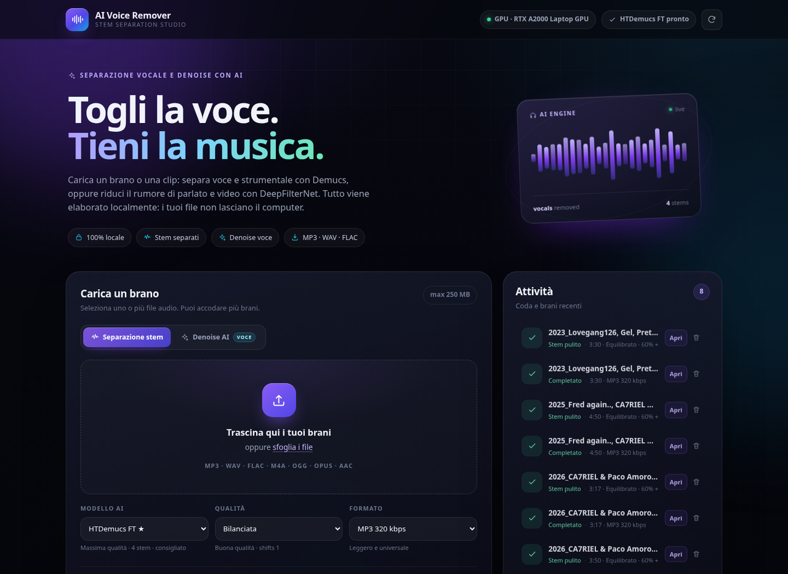

# 🎤 AI Voice Remover

Web app locale per separare **voce**, **strumentale** e singoli **stem** da qualsiasi brano
audio, e per fare **denoise AI post-produzione** su clip audio e video. Usa
[Demucs](https://github.com/facebookresearch/demucs) (Meta) e
[DeepFilterNet3](https://github.com/Rikorose/DeepFilterNet), con PyTorch.

Tutto gira sul tuo computer: nessun upload verso servizi esterni, nessun account,
nessuna quota. L'interfaccia è in italiano, responsive e funziona anche senza
connessione una volta scaricati i modelli.

   



---

## ✨ Cosa puoi fare

- **Strumentale + voce** in un unico passaggio, più batteria, basso e "altro".
- **Pulizia residui vocali** sulla strumentale: un secondo passaggio AI attenua la voce che resta nel mix.
- **Rimozione ronzio 50/60 Hz** con filtri notch stretti e rilevamento automatico delle armoniche.
- **Denoise AI delicato** su clip audio e video, con A/B prima/dopo.
- Modello **HTDemucs FT** di default (qualità massima), con alternative più veloci.
- **HTDemucs 6S** per separare anche chitarra e piano (6 stem).
- Tre preset di qualità: **Turbo**, **Bilanciata**, **Massima**.
- Output in **MP3 320 kbps**, **WAV 24-bit** o **FLAC 24-bit**.
- **Waveform interattive** con seek, confronto A/B originale/strumentale e download.
- **Coda multi-brano**, annullamento, nuovo tentativo, eliminazione.
- **Download ZIP** con tutti gli stem e nomi leggibili.
- **Ripresa dopo un riavvio**: i job interrotti tornano automaticamente in coda.
- **Pulizia automatica** dopo 24 ore (configurabile), con spazio disco indicato.
- Rilevamento automatico di **GPU CUDA / Apple Silicon / CPU**.
- Avvio con un comando: `./run.sh` (si auto-configura se manca qualcosa).

---

## 🚀 Avvio rapido

```bash
cd "ai-voice-remover"
./run.sh
```

Il launcher:

1. crea la virtualenv `.venv` se non esiste;
2. installa le dipendenze e verifica FFmpeg;
3. scarica i modelli AI (solo la prima volta);
4. avvia il server e apre il browser su **http://127.0.0.1:8791**.

Se l'istanza è già attiva, `./run.sh` riapre semplicemente il browser.

### Installazione separata

```bash
./install.sh                 # setup completo + modelli (Demucs + DeepFilterNet)
./install.sh --no-denoise    # solo separazione stem, senza motore denoise
./install.sh --denoise       # installa/ripara solo il motore denoise AI
./install.sh --no-prefetch   # setup senza scaricare i pesi Demucs
./install.sh --desktop       # aggiunge la voce nel menu applicazioni Linux
```

Il motore denoise usa una virtualenv dedicata (`.denoise-venv`, circa 900 MB)
per non alterare la versione di PyTorch usata da Demucs. Se non è disponibile,
la scheda “Denoise AI” resta disattivata e la separazione stem continua a funzionare.

### Avvio manuale

```bash
./run.sh --no-browser              # senza aprire il browser
./run.sh --port 8799               # porta diversa
AVR_DEVICE=cpu ./run.sh            # forza la CPU
python app.py                      # server diretto
waitress-serve --port=8791 app:app # server WSGI
```

### Sempre disponibile in background

```bash
./run.sh --background   # avvia in background, resta attivo anche chiudendo il terminale
./run.sh --status       # verifica se è attivo e mostra il PID
./run.sh --stop         # ferma il server
# log: logs/server.log
```

La voce di menu creata con `./install.sh --desktop` usa il launcher normale:
clicchi l'icona e l'app si apre nel browser.

**Requisiti:** Python 3.10+, FFmpeg/ffprobe nel `PATH`. PyTorch con CUDA è opzionale
ma consigliato: su GPU la separazione è molto più rapida. Il denoise AI richiede
Python 3.11 (gestito automaticamente da `uv` durante l'installazione) e gira su CPU.

---

## 🎛️ Modelli e qualità

| Modello | Stem | Note |
|---|---|---|
| `htdemucs_ft` | voce, batteria, basso, altro | Massima qualità (default), più lento |
| `htdemucs` | voce, batteria, basso, altro | Buon compromesso velocità/qualità |
| `htdemucs_6s` | + chitarra, piano | Utile per strumentali complesse |
| `mdx_extra_q` | voce, batteria, basso, altro | Meno memoria GPU |

| Preset | Shifts | Overlap | Uso |
|---|---|---|---|
| Turbo | 0 | 0.10 | Anteprime e brani lunghi |
| Bilanciata | 1 | 0.25 | Default |
| Massima | 2 | 0.25 | Massima pulizia |

I pesi vengono scaricati da HuggingFace la prima volta e restano nella cache
(`~/.cache/huggingface`). Puoi precaricarli con:

```bash
.venv/bin/python scripts/prefetch_models.py --model htdemucs_ft
```

---

## 🧹 Denoise AI (post-produzione)

La scheda **Denoise AI** pulisce il rumore di fondo da una clip **audio o video**,
mantenendo il video originale e confrontando prima/dopo con un player A/B.

### Tecnologia usata

- Modello **DeepFilterNet3** ([Rikorose/DeepFilterNet](https://github.com/Rikorose/DeepFilterNet)):
  rete di **speech enhancement** a due stadi che lavora a **48 kHz** su feature ERB
  e spettro complesso. È addestrata specificamente su voce/parlato, non è un
  semplice gate o un filtro spettrale.
- **Attenuazione limitata**: il parametro `atten_lim_db` miscela il segnale
  enhanced con quello originale. In pratica il modello non può togliere più
  di X dB di rumore, quindi il timbro e le sfumature restano naturali.
- **Post-filter disattivato**: evita di “mangiare” code, respiri e consonanti
  deboli, che è la causa più comune dell'effetto robotico.
- **Nessuna compressione, equalizzazione o normalizzazione di loudness**:
  l'audio conserva la dinamica originale.
- Le tracce stereo vengono processate **canale per canale**; il sample rate di
  lavoro è 48 kHz (standard video).
- Per i **video**, lo stream video viene **copiato senza ricodifica**
  (`-c:v copy`); cambia solo la traccia audio, ricodificata in **AAC 256 kbps**.
  Se il container non accetta la copia, il video viene ricodificato in H.264
  con CRF 18, cioè alta qualità.
- Inferenza su **CPU** in una virtualenv isolata (`.denoise-venv`), così da non
  toccare PyTorch/Demucs e non occupare la GPU. È molto più leggera della
  separazione: circa 0,02–0,05× la durata della clip.

### Preset di intensità

| Preset | Limite di attenuazione | Quando usarlo |
|---|---|---|
| **Delicato** | 4 dB | Timbro al primo posto, rumore già contenuto |
| **Naturale** (default) | 8 dB | Equilibrio pulizia/naturalezza |
| **Intenso** | 14 dB | Rumore evidente, voce comunque protagonista |

Puoi scegliere l'output **Automatico** (video → video, audio → MP3), **Video**,
**MP3 320**, **WAV 24-bit** o **FLAC 24-bit**. Il limite è 15 minuti per clip
(configurabile) e 250 MB.

> **Nota d'uso:** DeepFilterNet è pensato per **voce e parlato** (interviste,
> vlog, podcast, clip social). Per la musica è meglio usare la separazione stem:
> un denoiser vocale non distingue un'assenza di voce da un sintetizzatore.

---

## 🧽 Pulizia post-stem: residui vocali e ronzio

Nella schermata dei risultati di una separazione, accanto alla strumentale
compare **Pulisci stem**. Da lì puoi:

- ridurre la **voce residua** con un secondo passaggio AI;
- togliere il **ronzio elettrico** 50/60 Hz e le sue armoniche;
- fare entrambe le cose.

### Residui vocali

1. Il server copia lo stem strumentale già prodotto (l'originale non viene toccato).
2. Un secondo passaggio **HTDemucs FT** stima la voce ancora presente nello stem.
3. La voce stimata viene sottratta **solo in parte**:

   ```text
   output = strumentale - (percentuale × voce_residua)
   ```

4. Le percentuali sono volutamente conservative:

| Preset | Voce residua attenuata | Note |
|---|---|---|
| **Leggero** | 35% | Massima prudenza, per bleed appena percettibile |
| **Equilibrato** (default) | 60% | Buon compromesso qualità/pulizia |
| **Deciso** | 85% | Più incisivo, richiede sempre un ascolto A/B |

Perché non si sente "svuotato"? Perché non si sostituisce la strumentale con il
risultato del secondo passaggio: si sottrae solo una quota della voce stimata.
La parte musicale originale resta quindi la base del mix. Se il modello confonde
un synth con una voce, l'attenuazione parziale limita il danno; con **Leggero**
l'intervento è quasi impercettibile.

### Ronzio 50/60 Hz

Il ronzio elettrico è un problema **tonale**, non un rumore largo: non si affronta
con un denoiser vocale, che rovinerebbe la musica. Qui si usa un approccio DSP
mirato:

- analisi dello spettro per rilevare la frequenza di rete (**Auto** sceglie
  50 o 60 Hz confrontando le prime armoniche con il fondo spettrale);
- **peaking filter** stretti (Q ≈ 55) a −16 dB sulla fondamentale e sulle
  armoniche fino a 400 Hz;
- filtraggio **zero-phase** (`filtfilt`), quindi nessuno spostamento temporale
  percepibile;
- se non viene rilevato ronzio stabile, in modalità Auto non viene applicato
  alcun filtro.

Puoi forzare **50 Hz** o **60 Hz** se conosci la rete elettrica della registrazione,
oppure disattivare del tutto il ronzio.

> **Consiglio:** usa questa pulizia solo se senti davvero voce residua o ronzio.
> Il secondo passaggio è AI, ma il ronzio è meglio affrontarlo con notch precisi:
> un modello vocale applicato alla musica sarebbe molto più distruttivo.
> Confronta sempre in A/B e parti da **Leggero/Auto**.

---

## ⚙️ Configurazione

Tutte le variabili sono opzionali.

| Variabile | Default | Descrizione |
|---|---|---|
| `AVR_HOST` | `127.0.0.1` | Indirizzo di ascolto |
| `AVR_PORT` | `8791` | Porta HTTP |
| `AVR_DEVICE` | `auto` | `auto`, `cuda`, `mps`, `cpu` |
| `AVR_MODEL` | `htdemucs_ft` | Modello predefinito |
| `AVR_QUALITY` | `balanced` | `turbo`, `balanced`, `best` |
| `AVR_FORMAT` | `mp3` | `mp3`, `wav`, `flac` |
| `AVR_MAX_UPLOAD_MB` | `250` | Dimensione massima per brano |
| `AVR_RETENTION_HOURS` | `24` | Dopo quante ore eliminare i file |
| `AVR_CONCURRENCY` | `1` | Job in parallelo (lascia 1 con GPU piccole) |
| `AVR_JOB_TIMEOUT` | `0` | Timeout per job in secondi (0 = nessuno) |
| `AVR_UPLOADS_DIR` | `./uploads` | Cartella input temporanei |
| `AVR_OUTPUTS_DIR` | `./outputs` | Cartella risultati |
| `AVR_DATA_DIR` | `./data` | Stato persistente dei job |
| `AVR_LOGS_DIR` | `./logs` | Log dei worker (diagnostica) |
| `AVR_DENOISE_VENV` | `./.denoise-venv` | Ambiente Python dedicato al denoise |
| `AVR_DENOISE_PYTHON` | `…/.denoise-venv/bin/python` | Interprete del motore denoise |
| `AVR_DENOISE_MAX_MINUTES` | `15` | Durata massima di una clip da pulire |
| `AVR_DENOISE_THREADS` | auto | Thread CPU usati da DeepFilterNet |

Esempio:

```bash
AVR_DEVICE=cpu AVR_QUALITY=best AVR_PORT=9000 ./run.sh
AVR_DENOISE_MAX_MINUTES=30 ./run.sh
AVR_DENOISE_THREADS=4 ./install.sh --denoise
```

---

## 📁 Struttura

```
ai-voice-remover/
├── app.py                  # entrypoint WSGI + avvio
├── avr/
│   ├── __init__.py         # Flask app, rotte API, upload, download
│   ├── config.py           # modelli, preset, formati, impostazioni
│   ├── jobs.py             # coda, worker, persistenza, pulizia
│   ├── worker.py           # processo di separazione Demucs
│   └── polish_worker.py    # secondo passaggio: residui vocali
├── scripts/
│   ├── denoise_worker.py   # worker DeepFilterNet3 (audio + video)
│   ├── install_denoise.sh  # crea .denoise-venv e scarica il modello
│   ├── prefetch_models.py
│   └── install_desktop_entry.sh
├── templates/index.html
├── static/style.css | app.js | favicon.svg
├── tests/                  # pytest, worker simulato
├── uploads/ outputs/ logs/ data/   # dati runtime (ignorati da git)
├── .denoise-venv/          # ambiente isolato del denoise (ignorato da git)
├── install.sh | run.sh
└── requirements.txt
```

Ogni job gira in un **processo separato**: `python -m avr.worker` per Demucs,
`scripts/denoise_worker.py` nella `.denoise-venv` per DeepFilterNet. Un crash non
abbatte il server, l'annullamento libera subito le risorse e la memoria non resta
occupata tra un job e l'altro. Il processo padre legge eventi JSON (progresso
reale, fase, errori) e aggiorna lo stato persistente in `data/jobs.json`.

### API principali

| Metodo | Endpoint | Descrizione |
|---|---|---|
| `GET` | `/api/health` | Stato, GPU, motore denoise, modelli in cache, spazio disco |
| `GET` | `/api/jobs` | Coda e storico (separazione + denoise) |
| `POST` | `/api/upload` | Carica un file. Per la separazione: `file`, `model`, `quality`, `format`. Per il denoise: `file`, `kind=denoise`, `strength`, `format` |
| `GET` | `/api/jobs/<id>` | Stato del job |
| `POST` | `/api/jobs/<id>/cancel` | Annulla |
| `POST` | `/api/jobs/<id>/retry` | Rimette in coda (anche con nuove opzioni) |
| `POST` | `/api/jobs/<id>/polish` | Pulizia stem: residui voce e/o ronzio (`target`, `mode`, `strength`, `hum`, `format`) |
| `DELETE` | `/api/jobs/<id>` | Elimina job e file |
| `GET` | `/api/jobs/<id>/files/<key>` | Streaming audio/video (Range supportato) |
| `GET` | `/api/jobs/<id>/source` | File originale per il confronto A/B |
| `GET` | `/api/jobs/<id>/peaks/<key>` | Forma d'onda compatta per il player |
| `GET` | `/api/jobs/<id>/bundle.zip` | Archivio con tutti gli stem |

Esempio denoise via API:

```bash
curl -X POST http://127.0.0.1:8791/api/upload \
  -F "file=@clip.mp4" \
  -F "kind=denoise" \
  -F "strength=natural" \
  -F "format=auto"
```

---

## 🧪 Test

```bash
.venv/bin/pip install -r requirements-dev.txt
.venv/bin/python -m pytest -q
```

I test sostituiscono i worker con un fake, quindi sono veloci e non richiedono
GPU. Il flusso reale è stato verificato manualmente con:
Demucs → stem → MP3/ZIP, DeepFilterNet3 → audio pulito, remux video con
stream copiato (`-c:v copy`) e secondo passaggio di pulizia residui su un brano reale.

---

## 🛠️ Risoluzione problemi

**«Memoria GPU esaurita»** — usa il preset **Turbo**, il modello **MDX Extra Q**
oppure `AVR_DEVICE=cpu`. Con GPU da 4 GB evita job in parallelo.

**Il modello non si scarica** — controlla la connessione; il download riprende
dal punto interrotto. Puoi forzarlo con `scripts/prefetch_models.py`.

**Il denoise non è disponibile** — esegui `./install.sh --denoise`. Serve
Python 3.11 (oppure `uv`, che lo scarica automaticamente). L'ambiente è separato
per non toccare PyTorch/Demucs.

**La porta è occupata** — `./run.sh --port 8799` oppure `AVR_PORT=8799 ./run.sh`.

**Formati non riconosciuti** — installa FFmpeg:

```bash
sudo apt install ffmpeg      # Debian/Ubuntu
sudo dnf install ffmpeg      # Fedora
```

**Voglio ripartire da zero** — ferma il server e rimuovi
`uploads/*`, `outputs/*`, `data/jobs.json`, `logs/*`. Per rimuovere anche il
motore denoise: `rm -rf .denoise-venv` (i pesi restano in `~/.cache/DeepFilterNet`).

---

## ⚖️ Note

- Demucs è distribuito con licenza MIT; DeepFilterNet è dual-licensed MIT/Apache-2.0;
  PyTorch e FFmpeg hanno licenze proprie.
- Usa l'app solo su contenuti di cui possiedi i diritti o che puoi elaborare
  legalmente (karaoke, remix, studio, ricerca).
- I file restano sul tuo disco e vengono eliminati automaticamente secondo
  `AVR_RETENTION_HOURS`.
- L'app non ha autenticazione: per impostazione predefinita ascolta solo su
  `127.0.0.1`. Se la esponi sulla rete locale con `AVR_HOST=0.0.0.0`, chiunque
  possa raggiungere la porta può caricare e scaricare file. Non pubblicarla
  direttamente su Internet.

